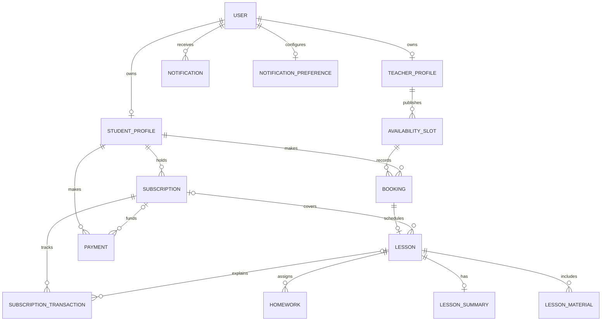

# Database

The current migration creates User and Role with a unique Telegram ID and a partial unique index that limits the database to one teacher. The relationships below describe the proposed domain model. Optional associations cover lessons booked before subscription tracking and free slots without bookings.

The VPS Compose stack runs PostgreSQL 17 with a project-scoped named volume and no host port. A one-shot Prisma migration service runs after an authenticated PostgreSQL health query succeeds. Compose constructs the same database URL for the API and migration service using the private `db` hostname and the dedicated database password. The migration job validates the URL before running Prisma. API startup requires a successful migration.

## Planned constraints

The availability migration adds one-off slots. PostgreSQL rejects overlapping open intervals with a partial exclusion constraint. See [the availability contract](SCHEDULE.md).

- Use UUID primary keys, foreign keys, creation and update timestamps, and a unique nullable Telegram ID. Index teacher availability by start time and student records by owner and date.
- Store instants in PostgreSQL timestamptz. Store the teacher's IANA time zone separately for local calendar input. Validate that end time follows start time, and decide how recurring slots cross daylight-saving changes.
- Use a PostgreSQL partial unique index on slot ID for active bookings. Make booking creation and slot checks transactional, and serialize booking against slot closure. Return a conflict when a slot is already booked. Preserve historical bookings when a student cancels and define the occupied states in the migration.
- Define an overlap constraint for teacher slots if overlapping availability is disallowed. Slot exclusivity alone protects only a single slot ID.
- Record subscription changes as signed ledger entries. Use a unique operation key for each debit or reversal and apply ledger changes atomically with lesson status. Retain audit history for teacher overrides.
- Store monetary amounts in minor units with a currency code. Record who confirmed a payment and when. Store notification delivery state and a unique event key scoped to the recipient.
