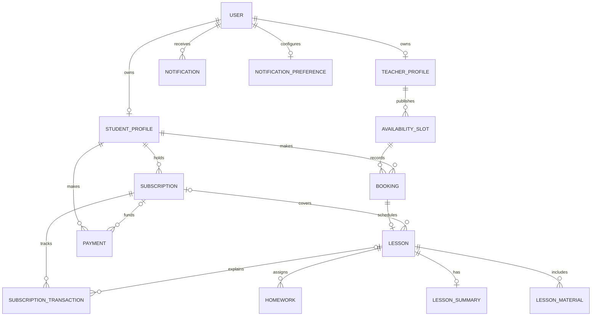

# Database

The current migration creates User and Role with a unique Telegram ID and a partial unique index that limits the database to one teacher. The relationships below describe the proposed domain model. Optional associations cover lessons booked before subscription tracking and free slots without bookings.

The VPS Compose stack runs PostgreSQL 17 with a project-scoped named volume and no host port. A one-shot Prisma migration service runs after an authenticated PostgreSQL health query succeeds. Compose constructs the same database URL for the API and migration service using the private `db` hostname and the dedicated database password. The migration job validates the URL before running Prisma. API startup requires a successful migration.

## Planned constraints

Booking moves retain the booking ID and store a snapshot of the original and new times, the teacher, and the operation ID. Moving a booking uses the same active-slot uniqueness constraint as booking. See [Student booking](BOOKING.md).

Teacher cancellations keep the optional student-facing reason and the reopening decision. A database check prevents teacher cancellations from being chargeable. See [Student booking](BOOKING.md).

Bookings record completion independently of ledger settlement. A check constraint excludes simultaneous cancellation and completion. Existing completed-lesson debits backfill the completion timestamp. See [Lesson credit ledger](CREDITS.md).

Lesson reminders use a composite booking and recipient key to prevent duplicate deliveries. Delivery state and retry timing are recorded separately from the booking. See [Lesson reminders](REMINDERS.md).

The lesson credit ledger stores immutable grants, debits and debit reversals. Dated grants are packages, and debits and reversals keep a reference to their source package. Existing credits remain non-expiring. A unique booking reference prevents duplicate settlement, and a unique self-reference ensures a debit can be reversed once. Writes lock the student's account row to protect concurrent balance changes. See [Lesson credit ledger](CREDITS.md).

Student accounts can store a nullable teacher-assigned display name. Existing accounts and newly invited students can remain unnamed. See [Student roster](STUDENTS.md).

Bookings use a partial unique index on the slot to allow one active reservation and retain cancelled reservations. Cancellation persists whether a lesson is chargeable for later credit settlement. Serializing calendar writes protects booking against concurrent closure and cancellation. See [Student booking](BOOKING.md).

Student invitations store a hashed code, expiry and redemption time. Redemption and student account creation are atomic. See [Student invitations](INVITATIONS.md).

The availability migration adds one-off slots. PostgreSQL rejects overlapping open intervals with a partial exclusion constraint. See [the availability contract](SCHEDULE.md).

- Use UUID primary keys, foreign keys, creation and update timestamps, and a unique nullable Telegram ID. Index teacher availability by start time and student records by owner and date.
- Store instants in PostgreSQL timestamptz. Store the teacher's IANA time zone separately for local calendar input. Validate that end time follows start time, and decide how recurring slots cross daylight-saving changes.
- Use a PostgreSQL partial unique index on slot ID for active bookings. Make booking creation and slot checks transactional, and serialize booking against slot closure. Return a conflict when a slot is already booked. Preserve historical bookings when a student cancels and define the occupied states in the migration.
- Define an overlap constraint for teacher slots if overlapping availability is disallowed. Slot exclusivity alone protects only a single slot ID.
- Record subscription changes as signed ledger entries. Use a unique operation key for each debit or reversal and apply ledger changes atomically with lesson status. Retain audit history for teacher overrides.
- Store monetary amounts in minor units with a currency code. Record who confirmed a payment and when. Store notification delivery state and a unique event key scoped to the recipient.
